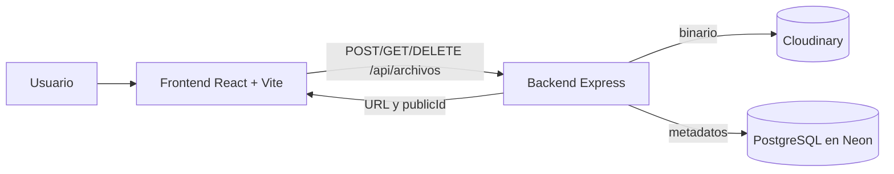

# Gestor de Activos Multimedia en la Nube

Aplicación para subir imágenes, videos y PDFs a la nube, guardar sus metadatos en una base de datos y gestionarlos con una API REST.

## Integrantes y roles

| Nombre | Rol | GitHub |
| Alejandra | Rol 1: Arquitecta Cloud y BD | @alejasld16 |
| (completar) | Rol 2 | |
| (completar) | Rol 3 | |
| (completar) | Rol 4: Frontend | |
| (completar) | Rol 5 | |

## Arquitectura



- **Cloudinary** guarda los archivos binarios (imágenes, videos y PDFs).
- **PostgreSQL en Neon** guarda los metadatos (título, URL, tipo, tamaño, fecha).

## Requisitos

- Node.js 20 o superior
- Cuenta en Cloudinary y en Neon

## Variables de entorno

Copia `backend/.env.example` a `backend/.env` y completa los valores. Nunca subas `.env` a GitHub.

## Instrucciones de ejecución

```bash
# Backend
cd backend
npm install
npx prisma migrate dev
npm run dev

# Frontend (en otra terminal)
cd frontend
npm install
npm run dev
```

## Endpoints

- `POST /api/archivos`: sube un archivo y guarda sus metadatos.
- `GET /api/archivos`: lista los archivos.
- `DELETE /api/archivos/:id`: borra el archivo de Cloudinary y su registro de la base de datos.